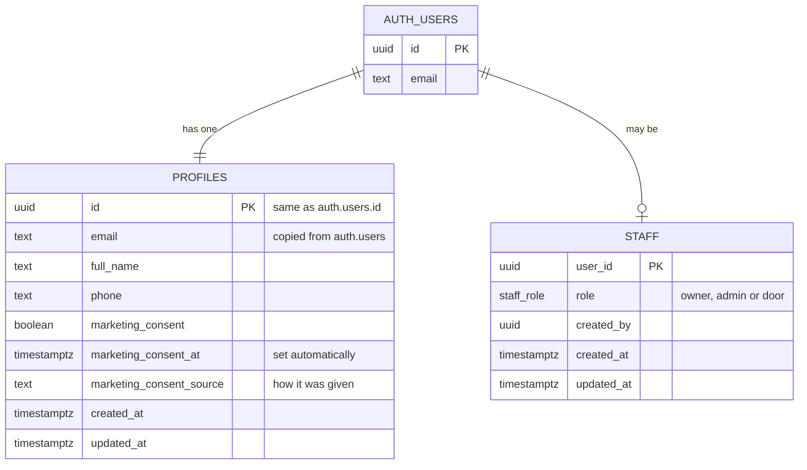

# Data model

The database is Supabase Postgres. Every table holding personal or booking
data has row level security (RLS), so the database itself decides who can see
and change each row, whatever the app does.

## Tables so far (Phase 0)

- **`auth.users`** belongs to Supabase Auth. A row is created the first time
  someone signs in with a code.
- **`profiles`** gets one row per person, created automatically by a trigger.
  Its email follows any change in `auth.users`.
- **`staff`** lists the Paper Fox team and their role.

## Who can do what

|                                           | Customer | Door staff | Admin | Owner |
| ----------------------------------------- | -------- | ---------- | ----- | ----- |
| Read own profile                          | ✓        | ✓          | ✓     | ✓     |
| Read other people's profiles              |          | ✓          | ✓     | ✓     |
| Change own name, phone, marketing consent | ✓        | ✓          | ✓     | ✓     |
| Change other people's profiles            |          |            | ✓     | ✓     |
| Change anyone's email directly            |          |            |       |       |
| Read own staff row                        |          | ✓          | ✓     | ✓     |
| Read, add, change and remove staff        |          |            |       | ✓     |

- Visitors who aren't signed in can't read either table at all.
- There must always be at least one owner. The database refuses to remove or
  demote the last one.
- The same rules are in `src/lib/auth/permissions.ts` for the app, and
  `tests/db/profiles-and-staff.test.ts` proves the database enforces them.

## Helper functions

These live in the `private` schema, which the API doesn't expose:

- `private.is_staff()`;
- `private.has_staff_role(roles)`;
- `private.current_staff_role()`.

RLS policies call them. They're `security definer`, so a policy on one table
can check the staff table without opening it up.

## Coming next

Following CLAUDE.md section 6, with the changes agreed in section 15:

| Phase | Tables                                                                                                                                                                        |
| ----- | ----------------------------------------------------------------------------------------------------------------------------------------------------------------------------- |
| 1     | `venues`, `events`, `ticket_types` (the 4pm and 9am options), `event_questions`                                                                                               |
| 2     | `bookings` (with references like `PF-2027-0001`), `booking_items`, `attendees`, `payments` (bank transfer, cash, other), `email_log`, `audit_log`, and the spreadsheet import |
| 3     | `waitlist`, holds and expiry, `scheduled_emails`                                                                                                                              |
| 4     | `refunds`, credit, event costs (for profit reports)                                                                                                                           |
