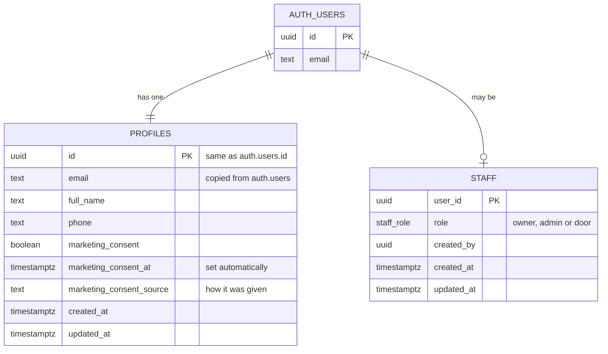
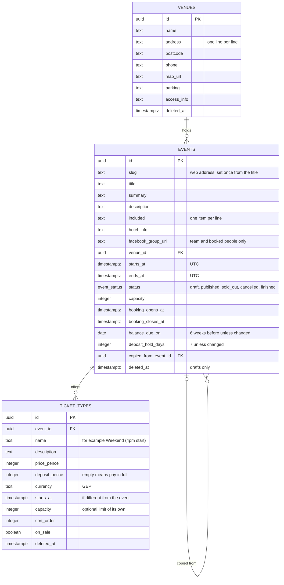
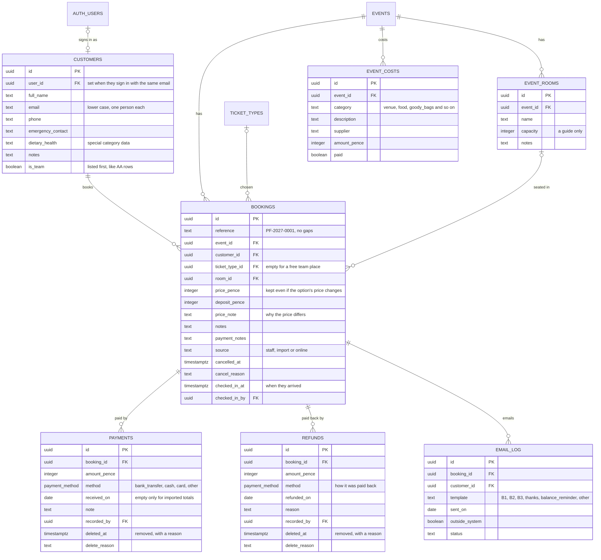
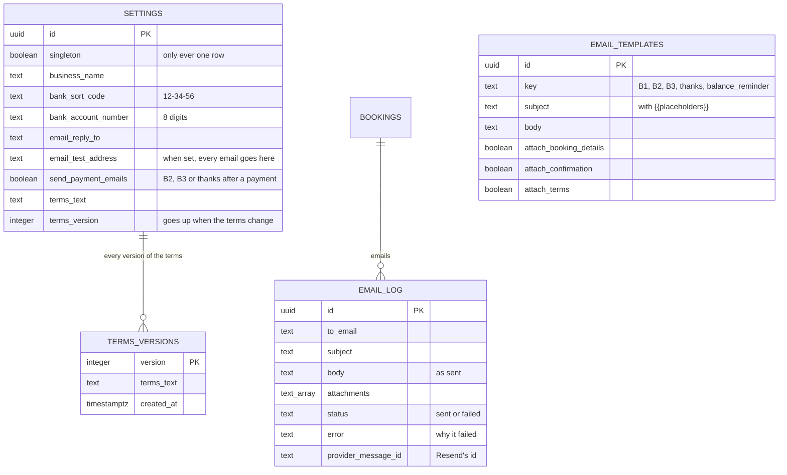

# Data model

The database is Supabase Postgres. Every table holding personal or booking
data has row level security (RLS), so the database itself decides who can see
and change each row, whatever the app does.

## People and the team (Phase 0)

- **`auth.users`** belongs to Supabase Auth. A row is created the first time
  someone signs in with a code.
- **`profiles`** gets one row per person, created automatically by a trigger.
  Its email follows any change in `auth.users`.
- **`staff`** lists the Paper Fox team and their role.

## Who can do what

|                                           | Customer | Door staff | Admin | Owner |
| ----------------------------------------- | -------- | ---------- | ----- | ----- |
| Read own profile                          | ✓        | ✓          | ✓     | ✓     |
| Read other people's profiles              |          | ✓          | ✓     | ✓     |
| Change own name, phone, marketing consent | ✓        | ✓          | ✓     | ✓     |
| Change other people's profiles            |          |            | ✓     | ✓     |
| Change anyone's email directly            |          |            |       |       |
| Read own staff row                        |          | ✓          | ✓     | ✓     |
| Read, add, change and remove staff        |          |            |       | ✓     |

- Visitors who aren't signed in can't read either table at all.
- There must always be at least one owner. The database refuses to remove or
  demote the last one.
- The same rules are in `src/lib/auth/permissions.ts` for the app, and
  `tests/db/profiles-and-staff.test.ts` proves the database enforces them.

## Events (Phase 1)

- **Money** is whole pence. A deposit must be more than £0 and less than the
  full price; empty means pay in full.
- **Dates** are stored in UTC and shown in UK time. The balance due date is a
  plain date, and must be before the UK date the event starts.
- **Statuses:** an event can only be published once it has an option on
  sale. A cancelled event can't be reopened. Only drafts can be deleted.
- **Copying** (`public.copy_event`) makes a draft with every date moved on by
  the same number of days, keeping UK clock times across the clocks
  changing. It copies the options but not the Facebook group, which is
  different for each event.
- **Moving** an event: when its start moves to another UK date, a trigger
  (`events_move_options`) moves each option's own start by the same number
  of days, keeping its UK clock time. Options without their own start, and
  removed options, are left alone.
- Every table has `created_at`, `updated_at` and `created_by`.

### Who can do what with events

|                                                                     | Visitor | Customer | Door staff | Admin | Owner |
| ------------------------------------------------------------------- | ------- | -------- | ---------- | ----- | ----- |
| Read published events, their options and venues                     | ✓       | ✓        | ✓          | ✓     | ✓     |
| Read an event's Facebook group, joining details and class kits text |         | ✓\*      | ✓          | ✓     | ✓     |
| Read drafts                                                         |         |          | ✓          | ✓     | ✓     |
| Add and change venues, events and options; copy events              |         |          |            | ✓     | ✓     |
| Change an event's web address, or who created a record              |         |          |            |       |       |
| Delete rows outright (records are marked deleted)                   |         |          |            |       |       |

\* Only for an event they have a booking on (not cancelled). Nobody signed
in can select these three columns directly: they come from
`public.event_private_details(event_ids)`, which gives them to the team and
to people booked on the event.

`tests/db/events.test.ts` and `tests/db/customer-settings.test.ts` prove
these rules.

## People, bookings and money (Phase 2)

- **One booking is one person's place on one event.** What they've paid and
  still owe is always worked out from their payments, never typed in.
- **Booking references** come from one counter per year, inside the
  booking's own transaction, so there are no gaps or duplicates.
- **No overbooking.** Adding a booking (or reinstating one) locks the event
  and checks its places, and the option's own limit if it has one. Two
  people taking the last place at the same moment can't both succeed.
- **Payments are never edited or deleted.** A mistake is removed with a
  reason, and stays in the history.
- **Refunds** work the same way. What someone has paid is always their
  payments less their refunds, everywhere (the people list, emails, reports
  and their account). A booking can never be refunded more than it's been
  paid: the database locks the booking and refuses a refund that would, or
  removing a payment that would leave it that way.
- **`public.import_bookings`** brings a checked spreadsheet into an event
  with nobody booked yet, all at once or not at all. It reuses people
  already on file (matched by email).
- **`audit_log`** records every change to events, options, bookings,
  payments and costs, with who made it. Nobody can change it.
- **`public.pass_place(booking_id, new_customer_id, reason)`** passes a
  place to someone else (owners and admins only): the booking, with its
  reference and payments, moves to them in one step, the reason is added to
  its notes, someone already booked on the event is refused, and the new
  person comes off the event's waiting list.
- **Linking accounts:** a person's record is linked to a sign-in account
  with the same email address once that address is confirmed, whether the
  account or the record came first.
- **`public.set_checked_in(booking_id, arrived)`** marks someone as arrived,
  or undoes it. Any team member can, door staff included, but only for a
  booking that isn't cancelled. Pressing Arrived twice keeps the first time.

### Who can do what with people and money

|                                                      | Customer | Door staff | Admin | Owner |
| ---------------------------------------------------- | -------- | ---------- | ----- | ----- |
| Read their own record, bookings, payments, refunds   | ✓        |            |       |       |
| Read everyone's records and bookings                 |          | ✓          | ✓     | ✓     |
| Add and change people, bookings and rooms            |          |            | ✓     | ✓     |
| Read and record payments and refunds; emails         |          |            | ✓     | ✓     |
| Check people in on the day                           |          | ✓          | ✓     | ✓     |
| Read and change costs; read the audit log            |          |            | ✓     | ✓     |
| Edit or delete a payment or refund, or the audit log |          |            |       |       |

Customers can't read the payments and refunds tables themselves:
`public.my_booking_money(booking_ids)` gives them the amounts, dates and
methods for their own bookings, without the team's notes.

`tests/db/bookings.test.ts`, `tests/db/refunds.test.ts`,
`tests/db/costs.test.ts` and `tests/db/check-in.test.ts` prove these rules.

## Settings and emails

- **Settings** is one row. Owners and admins can read it (the emails need
  the bank details); only owners can change it.
- **Terms:** changing the wording makes a new version in `terms_versions`,
  kept for good, so we always know what someone was sent. The terms are
  public, so anyone can read them.
- **Email wording** is in `email_templates`. Owners and admins change it.
- **The email log** can't be changed by anyone. The system adds to it
  through `public.log_email()`, which only owners and admins can use.
  Emails sent outside the system can still be recorded by hand.

`tests/db/settings-and-emails.test.ts` proves these rules.

## The waiting list

- **`waitlist`**: event, customer, the option they'd like, notes, status
  (`waiting`, `offered`, `booked`, `declined`, `removed`), when a place was
  offered and the last day to accept, and the booking once they're booked.
- Someone can only be waiting (or offered a place) once per event.
- **`public.book_from_waitlist(waitlist_id, option_id, room_id)`** makes the
  booking at the option's price and marks them booked, together. The
  booking's own checks still apply, so a full event refuses it.
- Owners and admins only. `tests/db/waiting-list.test.ts` proves these rules.

## Helper functions

These live in the `private` schema, which the API doesn't expose:

- `private.is_staff()`;
- `private.has_staff_role(roles)`;
- `private.current_staff_role()`.

RLS policies call them. They're `security definer`, so a policy on one table
can check the staff table without opening it up.

## Coming next

Following CLAUDE.md section 6, with the changes agreed in section 15:

| Phase | Tables                                                                               |
| ----- | ------------------------------------------------------------------------------------ |
| 2     | Sending the B1, B2 and B3 emails, balance reminders and chasers (`scheduled_emails`) |
| 3     | `waitlist`, holds and expiry, `scheduled_emails`                                     |
| 4     | Credit towards a future event                                                        |
