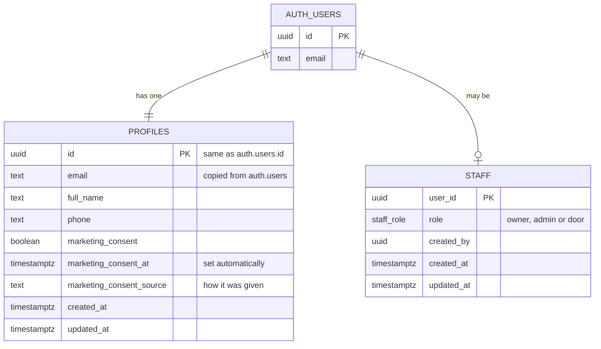
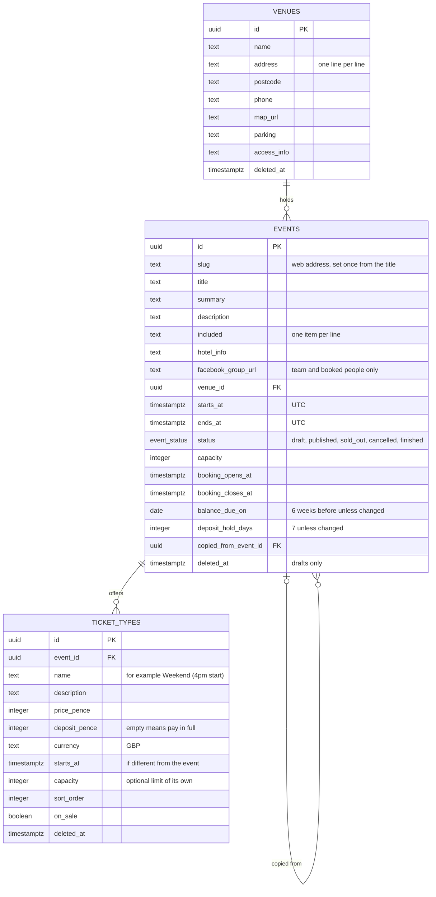

# Data model

The database is Supabase Postgres. Every table holding personal or booking
data has row level security (RLS), so the database itself decides who can see
and change each row, whatever the app does.

## People and the team (Phase 0)

- **`auth.users`** belongs to Supabase Auth. A row is created the first time
  someone signs in with a code.
- **`profiles`** gets one row per person, created automatically by a trigger.
  Its email follows any change in `auth.users`.
- **`staff`** lists the Paper Fox team and their role.

## Who can do what

|                                           | Customer | Door staff | Admin | Owner |
| ----------------------------------------- | -------- | ---------- | ----- | ----- |
| Read own profile                          | ✓        | ✓          | ✓     | ✓     |
| Read other people's profiles              |          | ✓          | ✓     | ✓     |
| Change own name, phone, marketing consent | ✓        | ✓          | ✓     | ✓     |
| Change other people's profiles            |          |            | ✓     | ✓     |
| Change anyone's email directly            |          |            |       |       |
| Read own staff row                        |          | ✓          | ✓     | ✓     |
| Read, add, change and remove staff        |          |            |       | ✓     |

- Visitors who aren't signed in can't read either table at all.
- There must always be at least one owner. The database refuses to remove or
  demote the last one.
- The same rules are in `src/lib/auth/permissions.ts` for the app, and
  `tests/db/profiles-and-staff.test.ts` proves the database enforces them.

## Events (Phase 1)

- **Money** is whole pence. A deposit must be more than £0 and less than the
  full price; empty means pay in full.
- **Dates** are stored in UTC and shown in UK time. The balance due date is a
  plain date, and must be before the UK date the event starts.
- **Statuses:** an event can only be published once it has an option on
  sale. A cancelled event can't be reopened. Only drafts can be deleted.
- **Copying** (`public.copy_event`) makes a draft with every date moved on by
  the same number of days, keeping UK clock times across the clocks
  changing. It copies the options but not the Facebook group, which is
  different for each event.
- Every table has `created_at`, `updated_at` and `created_by`.

### Who can do what with events

|                                                        | Visitor | Customer | Door staff | Admin | Owner |
| ------------------------------------------------------ | ------- | -------- | ---------- | ----- | ----- |
| Read published events, their options and venues        | ✓       | ✓        | ✓          | ✓     | ✓     |
| Read an event's Facebook group                         |         | ✓\*      | ✓          | ✓     | ✓     |
| Read drafts                                            |         |          | ✓          | ✓     | ✓     |
| Add and change venues, events and options; copy events |         |          |            | ✓     | ✓     |
| Change an event's web address, or who created a record |         |          |            |       |       |
| Delete rows outright (records are marked deleted)      |         |          |            |       |       |

\* Signed-in customers can currently read it for published events. Once
bookings exist (Phase 2), this will be limited to people booked on the
event.

`tests/db/events.test.ts` proves these rules.

## Helper functions

These live in the `private` schema, which the API doesn't expose:

- `private.is_staff()`;
- `private.has_staff_role(roles)`;
- `private.current_staff_role()`.

RLS policies call them. They're `security definer`, so a policy on one table
can check the staff table without opening it up.

## Coming next

Following CLAUDE.md section 6, with the changes agreed in section 15:

| Phase | Tables                                                                                                                                                                        |
| ----- | ----------------------------------------------------------------------------------------------------------------------------------------------------------------------------- |
| 2     | `bookings` (with references like `PF-2027-0001`), `booking_items`, `attendees`, `payments` (bank transfer, cash, other), `email_log`, `audit_log`, and the spreadsheet import |
| 3     | `waitlist`, holds and expiry, `scheduled_emails`                                                                                                                              |
| 4     | `refunds`, credit, event costs (for profit reports)                                                                                                                           |
